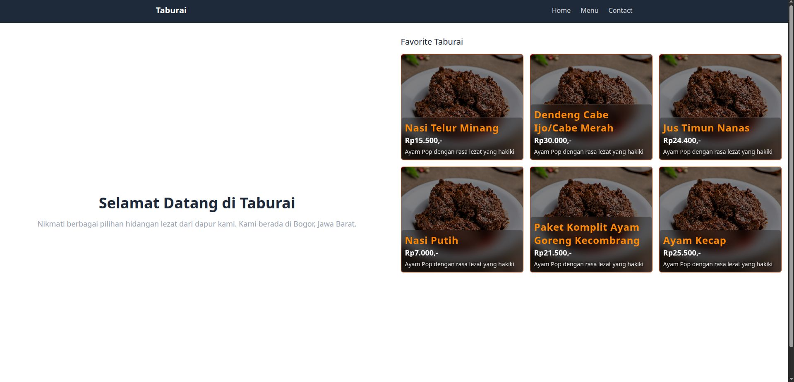
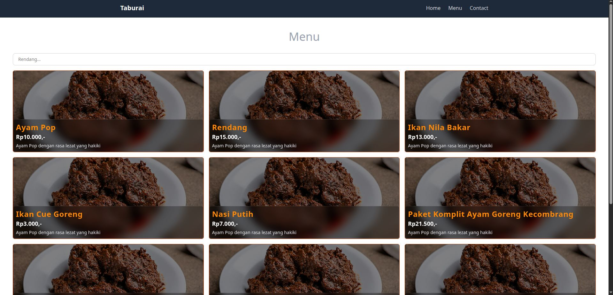
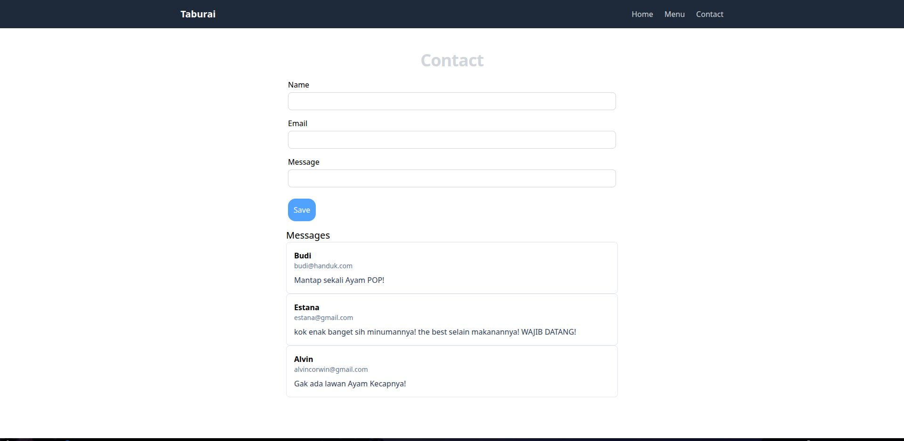

# Homework 2 - Taburai (React JS & Tailwind CSS)

**Taburai** adalah aplikasi web kuliner yang menampilkan banyak menu makanan tradisional Indonesia. Juga bisa memberikan pesan di bagian contact.

---

## 📸 Tampilan Halaman (Screenshots)

> _Catatan: Gantilah URL/path gambar di bawah ini dengan gambar screenshot sesuai hasil tangkapan layar project Anda di lokal._

### 1. Halaman Beranda (Home)

Menampilkan informasi utama usaha, banner hero, serta daftar produk favorit yang disajikan dalam bentuk kartu menu (_cards_).


### 2. Halaman Daftar Menu & Pencarian (Menu)

Menampilkan katalog makanan lengkap dengan gambar, deskripsi, kategori, serta fitur pencarian menu secara real-time berdasarkan kata kunci nama hidangan.


### 3. Halaman Kontak Us (Contact Us)

Menampilkan formulir pesan interaktif serta riwayat pesan yang telah dikirim dan tersimpan secara otomatis menggunakan browser `localStorage`.


---

## 🔄 Alur Penggunaan Website

1. **Navigasi Antar Halaman (`React Router`):**
   - Pengunjung dapat berpindah halaman secara cepat tanpa _reload_ browser melalui menu di bagian atas.
   - Pilihan navigasi mencakup **Home**, **Menu**, dan **Contact Us**.
   - Di tampilan perangkat seluler (_mobile view_).

2. **Pencarian Menu (`Search Feature`):**
   - Masuk ke halaman **Menu**.
   - Ketikkan nama hidangan yang ingin dicari pada kolom pencarian (_search bar_).
   - Daftar menu akan secara otomatis tersaring secara _real-time_ sesuai dengan teks yang dimasukkan.
   - Apabila produk tidak ditemukan, aplikasi akan menampilkan pesan pemberitahuan yang informatif.

3. **Pengiriman Pesan (`Form & LocalStorage`):**
   - Masuk ke halaman **Contact Us**.
   - Isi formulir yang terdiri dari **Nama**, **Email**, dan **Pesan**.
   - Klik tombol **Kirim Pesan**.
   - Pesan yang berhasil dikirim akan langsung tersimpan ke `localStorage` web browser dan ditampilkan pada daftar riwayat pesan di bawah formulir.

---

## 🛠️ Teknologi & Fitur Utama

- **React JS (Vite):** Framework UI berbasis komponen.
- **React Router DOM v6:** Manajemen rute dan navigasi Single Page Application (SPA).
- **Tailwind CSS:** Framework CSS _utility-first_ untuk desain yang modern, konsisten, dan responsif.
- **State & Props Management:** Pengelolaan alur data dan komponen reusable (`ProductCard`).
- **Web Storage API (`localStorage`):** Penyimpanan data pesan pengguna secara persisten di browser.

---

## 🚀 Cara Menjalankan Project

Ikuti langkah-langkah di bawah ini untuk menjalankan project di lingkungan lokal (_development environment_):

### Prasyarat

Pastikan Anda sudah menginstal [Node.js](https://nodejs.org/) (versi 16 atau yang terbaru) di perangkat Anda.

### Langkah Instalasi & Lisensi

1. **Clone repository ini ke komputer Anda:**

   ```bash
   git clone https://github.com/icangku/koda-b1-react3-homework.git
   ```

2. **Masuk ke direktori project:**

   ```bash
   cd koda-b1-react3-homework
   ```

3. **Install seluruh dependensi project:**

   ```bash
   npm install
   ```

4. **Jalankan server pengembangan (Development Server):**

   ```bash
   npm run dev
   ```

5. **Buka di browser:**
   Buka alamat URL yang tertera pada terminal (biasanya `http://localhost:5173/`).

---

_Dibuat untuk memenuhi Tugas Homework 2 - React & Tailwind CSS._
